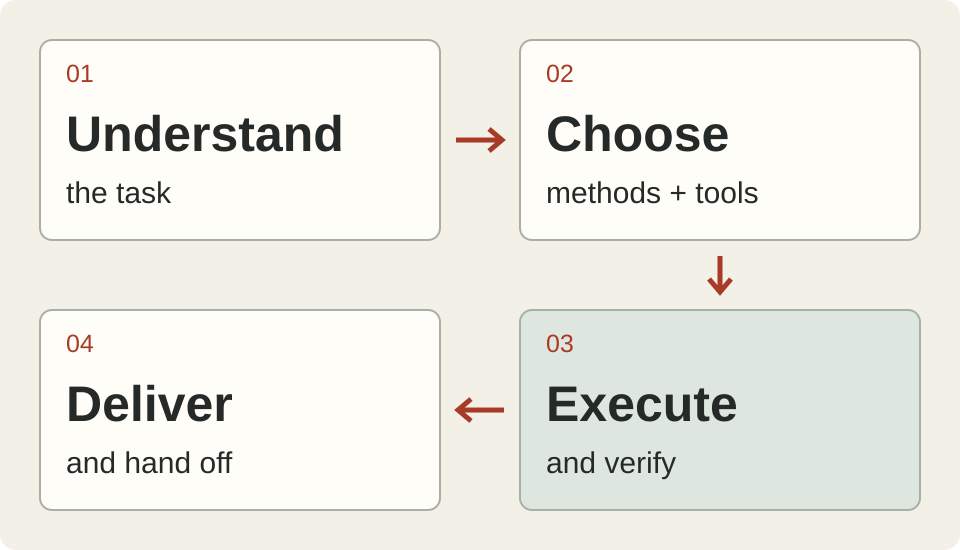

<h1 align="center">Codex Workflow Toolbox</h1>

<p align="center">A working environment for research, implementation, verification, and handoff.<br>
<strong>62 user Skills · 4 roles · 31 tool routes · A pinned Windows reference environment</strong></p>

<p align="center"><strong>English</strong> · <a href="README.zh-CN.md">简体中文</a><br>
<a href="#let-codex-set-it-up">Guided setup</a> · <a href="#reproduce-the-environment">Reproduce</a> · <a href="#contents">Contents</a> · <a href="#backup-and-use">Backup and use</a></p>

<p align="center"></p>

This is the agent environment I use for coding, research, and documents. It includes working agreements, Skills, roles, configuration, harness source, and dependency recipes. Full reproduction creates a separate Codex home and installs tools from pinned upstream artifacts.

**Back up your projects and existing agent configuration first.** Choose a new directory outside the repository and keep the original environment. Accounts, secrets, and client-generated connections belong to the reader. See the [full guide](docs/full-environment.en.md).

## What you can use it for

| Work | Methods |
| --- | --- |
| Research and understand code before editing | On-demand Skills, official docs MCP, syntax and symbol navigation |
| Coordinate a larger task | Dependencies, file ownership, separate worktrees, task-based roles |
| Check whether the result works | Tests, UI operations, artifact inspection, independent review |
| Continue longer work | Project notes, checkpoints, evidence records, and a next action |
| Improve your own workflow | Keep the baseline and compare changes on the same task and checks |

## Let Codex set it up

Give your own Codex this prompt so it can inspect your computer and existing setup first.

```text
Read https://github.com/Naaeeen/codex-agent-workflow .

Inspect my OS, Python, Codex, and current agent configuration.
Back up my projects and agent settings, and keep a recovery procedure.
Follow the README and full guide to preview and create the environment
in a new directory outside the repository.
Review the manifest, install the required pinned groups, and verify each part.
Use my own accounts, secrets, and private project values in local storage.
Preserve my original environment and uncommitted work.
Report what works and what still needs installation or account connection.
```

## Reproduce the environment

The reference dependency set targets **Windows x64**. Full restoration needs **Python 3.13.7 and 3.14.3**. The patched wheels also check the compression-library version. See the [full guide](docs/full-environment.en.md) for preparation and group-specific commands. Model assets total approximately 3 GB, with additional space needed for software and dependencies.

```powershell
git clone https://github.com/Naaeeen/codex-agent-workflow.git
Set-Location codex-agent-workflow

$py313 = py -3.13 -c "import sys; print(sys.executable)"
$py314 = py -3.14 -c "import sys; print(sys.executable)"

# Preview with an explicit Python path
pwsh -NoProfile -File ./setup.ps1 -Destination ../my-codex-environment -Python313 $py313

# Explicitly create the environment and download pinned dependencies
pwsh -NoProfile -File ./setup.ps1 -Destination ../my-codex-environment `
  -Python313 $py313 -Python314 $py314 -Apply

# Sign in to the separate environment with your own account
& $py313 ../my-codex-environment/launch.py -- login

# Use the setup in your project
& $py313 ../my-codex-environment/launch.py --project C:/path/to/my-project
```

Preview is the default. `-Apply` runs the 30 automatic dependency groups. Add `-SkipModelWeights` to defer QMD and Docling assets. An existing target must pass its recorded checks before continuing. Modified files are reported instead of overwritten.

```text
my-codex-environment/
├── launch.py
├── codex-home/
│   ├── AGENTS.md + config.toml
│   ├── agents/       Four role types
│   ├── skills/       62 user Skills
│   ├── harness/      Evidence, eval, observation, and handoff
│   └── tools/        Controllers and isolated tool environments
├── project/          Initial workspace
└── tooling/          Recipes, host references, and licenses
```

For a smaller project-local trial, use the [project starter](docs/project-starter.md).

## Contents

| Component | Entry point |
| --- | --- |
| Full file and dependency manifests | [Files](environment/manifest.json) · [Dependency groups](environment/dependencies.json) |
| Recorded settings and privacy adaptations | [Sanitized snapshot](config/config.sanitized.toml) · [Settings](docs/settings.en.md) |
| Standing working agreements | [AGENTS.md](templates/global-AGENTS.md) |
| User Skills and provenance | [62 Skills](environment/bundle/codex-home/skills/) · [Origins and adaptations](environment/portability.json) |
| Agent responsibilities | [Four role templates](config/agents-current-schema/) |
| Complete tool entry | [31-route launcher](environment/bundle/codex-home/tools/agent-kit/agent-tool.ps1) |
| Harness source and tests | [Full source](environment/bundle/codex-home/harness/) · [Seven portable routes](config/tooling/README.md) |
| Plugins and host settings | [Host reference](environment/bundle/tooling/host-settings.reference.json) · [Setup steps](docs/full-environment.en.md) |
| Methods and task records | [Workflows](docs/workflows.en.md) · [Templates](templates/) · [Evolution](docs/evolution.en.md) |

Your official client supplies its system Skills and hosted plugins. Sign-in state, secrets, private projects, chats, memory content, and historical command approvals remain with their owners. The older restricted `docx` installation is replaced with an identified official Apache revision. See the [reproduction scope](docs/full-environment.en.md).

## Check the installation

```powershell
$py313 = py -3.13 -c "import sys; print(sys.executable)"
& $py313 -B reproduce.py ../my-codex-environment --verify
& $py313 -B install_dependencies.py ../my-codex-environment
pwsh -NoProfile -File ../my-codex-environment/codex-home/tools/agent-kit/agent-tool.ps1 --help
```

`[verified]` means the installed group passed its file checks. `[plan ...]` is not installed and `[manual]` needs reader action. A successful status-command exit means inspection completed. Client-written or deliberate configuration changes are reported as differences to inspect.

Read [environment verification](docs/reproduction-verification.md) and [original core verification](VERIFICATION.md). Account connectivity and real-task results need checking in your environment.

## Backup and use

This personal setup is provided as-is. Systems, clients, and projects differ. Decide what fits your use and accept the risks of applying it. Back up the complete project and agent configuration, and confirm recovery before making changes. Keep backups, secrets, and run records in private storage. Publish only reviewed source material.

Original work uses [MIT](LICENSE). Third-party content retains its own terms in [licensing and provenance](THIRD_PARTY_NOTICES.md). Components such as GitNexus have separate use conditions.

[Open an issue](https://github.com/Naaeeen/codex-agent-workflow/issues/new) with your task, version, steps, and minimal shareable evidence.

The homepage draws on [Superpowers](https://github.com/obra/superpowers) for workflow and installation entry points, [ECC](https://github.com/affaan-m/ECC) for guided setup and indexing, and [Claude Code Best Practice](https://github.com/shanraisshan/claude-code-best-practice) for the component-to-file map.
