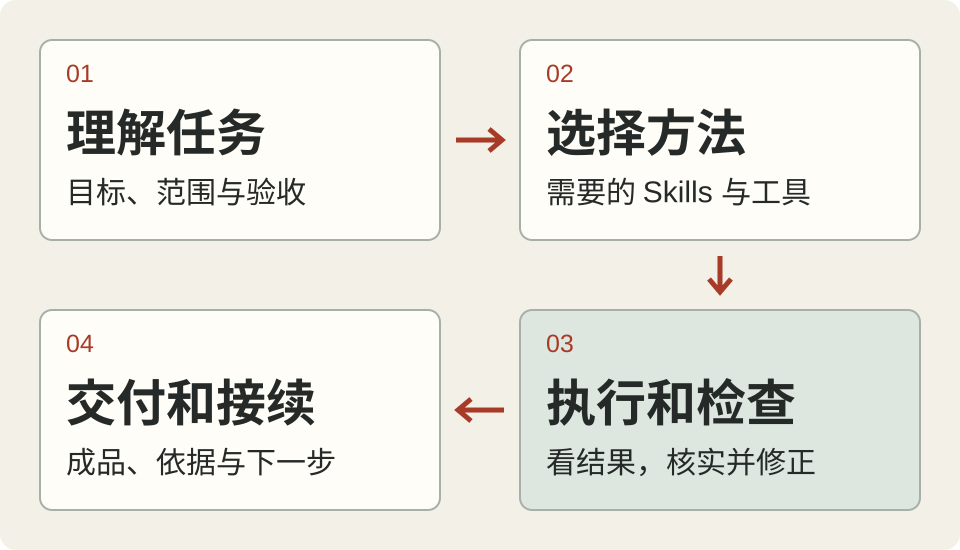

<h1 align="center">我的 Codex 工作流工具箱</h1>

<p align="center">研究、实现、检查、交接，接成一套日常工作方式。<br>
<strong>62 个用户 Skills · 4 类角色 · 31 个工具入口 · 固定版本的 Windows 环境</strong></p>

<p align="center"><a href="README.md">English</a> · <strong>简体中文</strong><br>
<a href="#让-codex-帮你配置">让 Codex 帮你配置</a> · <a href="#自己复现">自己复现</a> · <a href="#内容地图">内容地图</a> · <a href="#备份与使用">备份与使用</a></p>

<p align="center"></p>

这是我用来做代码、研究和文档的 Agent 工作环境。仓库包含工作约定、Skills、角色、配置、harness 源码和依赖配方。完整复现会建立一个独立的 Codex 配置目录，从固定版本的上游来源安装工具。

**先完整备份项目和现有 Agent 配置**，选择仓库外的新目录，保留原环境。账号、密钥和客户端生成的连接由使用者自己配置，详见[完整复现指南](docs/full-environment.zh-CN.md)。

## 能用它做什么

| 工作 | 用到的方法 |
| --- | --- |
| 查资料、读代码，再动手 | Skills 按需加载、官方文档 MCP、语法与符号检索 |
| 拆开大任务一起推进 | 任务依赖、文件归属、独立工作目录、按任务选角色 |
| 检查结果是否真的完成 | 测试、实际界面操作、成品检查、独立复核 |
| 分几次完成长任务 | 项目记录、检查点、证据账本和下一步 |
| 优化自己的 Agent 用法 | 保留原方案，用同一任务和验收比较改法 |

## 让 Codex 帮你配置

把下面这段直接发给自己的 Codex，让它先检查你的电脑和已有设置。

```text
请阅读 https://github.com/Naaeeen/codex-agent-workflow 。

检查我的操作系统、Python、Codex 和当前 Agent 配置。
先完整备份我的项目和 Agent 设置，保留恢复方法。
按 README 和完整复现指南，在仓库外的新目录预览并建立环境。
检查清单后安装所需的固定版本依赖，逐项验证。
账号、密钥和私有项目参数使用我自己的，保存到本地适当位置。
保留我的原环境和未提交工作，最后说清能用的部分和待接入项目。
```

## 自己复现

依赖参考环境为 **Windows x64**，完整安装需要 **Python 3.13.7 和 3.14.3**。补丁 wheel 还会核对压缩库版本，准备条件和分组操作见[完整指南](docs/full-environment.zh-CN.md)。模型资产约 3 GB，另需程序和依赖空间。

```powershell
git clone https://github.com/Naaeeen/codex-agent-workflow.git
Set-Location codex-agent-workflow

$py313 = py -3.13 -c "import sys; print(sys.executable)"
$py314 = py -3.14 -c "import sys; print(sys.executable)"

# 只预览，使用明确的 Python 路径
pwsh -NoProfile -File ./setup.ps1 -Destination ../my-codex-environment -Python313 $py313

# 明确执行复现与依赖下载
pwsh -NoProfile -File ./setup.ps1 -Destination ../my-codex-environment `
  -Python313 $py313 -Python314 $py314 -Apply

# 使用自己的账号登录独立环境
& $py313 ../my-codex-environment/launch.py -- login

# 用这套配置处理自己的项目
& $py313 ../my-codex-environment/launch.py --project C:/path/to/my-project
```

默认只预览，`-Apply` 执行 30 个自动依赖组。可加 `-SkipModelWeights` 暂缓 QMD/Docling 模型下载。已有目标必须通过文件校验才能续装，修改过的文件会报告差异。

```text
my-codex-environment/
├── launch.py
├── codex-home/
│   ├── AGENTS.md + config.toml
│   ├── agents/       四类角色
│   ├── skills/       62 个用户 Skills
│   ├── harness/      账本、评测、观测与交接
│   └── tools/        控制器与独立工具环境
├── project/          初始工作目录
└── tooling/          依赖配方、宿主参考与许可
```

想先在单个项目里试核心方法，可以用[较轻的项目启动方式](docs/project-starter.md)。

## 内容地图

| 内容 | 从这里进入 |
| --- | --- |
| 完整文件与依赖清单 | [文件](environment/manifest.json) · [依赖组](environment/dependencies.json) |
| 保存的设置与隐私替换 | [脱敏快照](config/config.sanitized.toml) · [设置说明](docs/settings.md) |
| 全局工作约定 | [AGENTS.md](templates/global-AGENTS.md) |
| 用户 Skills 与来源 | [62 个 Skills](environment/bundle/codex-home/skills/) · [来源与改动](environment/portability.json) |
| Agent 职责 | [四类角色](config/agents-current-schema/) |
| 完整工具入口 | [31 路由启动器](environment/bundle/codex-home/tools/agent-kit/agent-tool.ps1) |
| harness 源码和测试 | [完整源码](environment/bundle/codex-home/harness/) · [便携七入口](config/tooling/README.md) |
| 插件和宿主设置 | [宿主参考](environment/bundle/tooling/host-settings.reference.json) · [接入步骤](docs/full-environment.zh-CN.md) |
| 工作方法和任务模板 | [工作方法](docs/workflows.md) · [模板](templates/) · [持续改进](docs/evolution.md) |

系统 Skills 和宿主插件由自己的官方客户端提供。登录态、密钥、私有项目、聊天、记忆内容和历史授权命令留在各自机器。旧版受限 `docx` 使用明确标注的官方 Apache 版本替代。详情见[复现范围](docs/full-environment.zh-CN.md)。

## 检查安装结果

```powershell
$py313 = py -3.13 -c "import sys; print(sys.executable)"
& $py313 -B reproduce.py ../my-codex-environment --verify
& $py313 -B install_dependencies.py ../my-codex-environment
pwsh -NoProfile -File ../my-codex-environment/codex-home/tools/agent-kit/agent-tool.ps1 --help
```

状态为 `[verified]` 表示该依赖组通过已安装文件校验，`[plan ...]` 表示尚未安装，`[manual]` 需要自行接入。清单命令退出成功只表示检查完成。客户端或你后续改过的配置也会显示差异，请先查看变化再处理。

验证范围见[复现验证](docs/reproduction-verification.md)和[原核心验证](VERIFICATION.md)。账号连通性与真实任务效果要在自己的环境确认。

## 备份与使用

这是个人工作流，按现状提供。系统、客户端和项目不同，使用者需要自行判断适用性并承担使用风险。动手前请完整备份项目和 Agent 配置，确认能恢复。备份、密钥和运行记录放在自己的安全位置，公开分享只使用审查过的源文件。

原创部分采用 [MIT](LICENSE)，第三方内容保留各自许可，见[许可与来源](THIRD_PARTY_NOTICES.md)。GitNexus 等组件有单独使用条件。

欢迎带着具体任务、版本、步骤和最小可公开材料[提 Issue](https://github.com/Naaeeen/codex-agent-workflow/issues/new)。

首页组织参考 [Superpowers](https://github.com/obra/superpowers) 的工作方式与安装入口、[ECC](https://github.com/affaan-m/ECC) 的引导配置和能力索引，以及 [Claude Code Best Practice](https://github.com/shanraisshan/claude-code-best-practice) 的组件与文件对应表。
